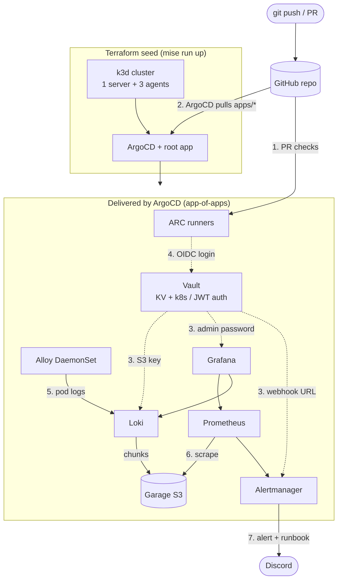

# Kubernetes GitOps Platform

A self-hosted Kubernetes platform that rebuilds from nothing in under 8 minutes with one manual step. Terraform seeds a k3d cluster and ArgoCD; ArgoCD delivers every other workload from this repo. Secrets come from HashiCorp Vault (no static credentials in Git or CI), CI runs on in-cluster runners that log in to Vault with GitHub OIDC, and Prometheus, Grafana and Loki turn failures into a Discord alert with a runbook link.

Built as a portfolio project on a single Linux box. Every tool is here because of a problem it solves; the reasoning is in the [ADRs](docs/adr/).

## Architecture



1. **PR checks**: every PR runs `terraform fmt/validate`, `kubeconform` and `helm template` on ephemeral in-cluster runners. In GitOps, merge = deploy, so the PR is the gate.
2. **GitOps**: Terraform installs only the cluster and ArgoCD (the seed). ArgoCD's root app syncs every child `Application` in `argocd/`, with self-heal on. Nothing is `kubectl apply`'d by hand ([ADR-0003](docs/adr/0003-tf-argocd-delivery-boundary.md)).
3. **Secrets**: pods log in to Vault with their ServiceAccount; an agent writes the secret to a file in the pod. No k8s Secret, no value in Git. One role and one read-only policy per consumer ([ADR-0004](docs/adr/0004-vault-secrets.md)).
4. **Keyless CI**: the job's GitHub OIDC token is accepted only for this repo, `main`, and Vault's audience; the Vault token lives 5 minutes ([ADR-0005](docs/adr/0005-ci-arc-runners-vault-jwt.md)).
5. **Logs**: Alloy tails every pod's logs; Loki stores them in Garage, a self-hosted S3 store ([ADR-0002](docs/adr/0002-object-store-garage-no-native-locking.md)). A NetworkPolicy lets only Loki and Prometheus reach Garage.
6. **Metrics**: scrape targets and alert rules are CRDs kept next to each workload in Git.
7. **Alerting**: critical alerts go to Discord with a runbook link (`docs/runbooks/`); a Grafana panel links straight from Garage metrics to its logs ([ADR-0006](docs/adr/0006-observability-stack.md)).

## Stack

| Tool | Because |
|---|---|
| Terraform | the cluster and ArgoCD must exist before GitOps can start; TF owns only that seed |
| k3d | a multi-node Kubernetes cluster on one box (nodes are containers), created and destroyed by one command |
| ArgoCD | continuous reconcile from Git: audit trail, revert by commit, drift self-heal |
| HashiCorp Vault | one place for secrets, read by workload identity, never stored in Git or CI |
| GitHub Actions + ARC | CI needs to reach Vault, which is never exposed; runners live in the cluster |
| Prometheus + Alertmanager | metrics and alert rules as code, routed to a person |
| Grafana | one UI for metrics and logs, dashboards and datasources as code |
| Loki + Alloy | logs indexed by labels only, cheap to run, same labels as metrics |
| Garage | S3-compatible store for Loki on the same box (MinIO community edition is archived) |
| Forgejo | sample stateful app (Deployment, 5Gi PVC, Ingress at `forgejo.localhost:8080`) proving GitOps delivery of a workload with data |
| mise | pins tool versions and wraps the lifecycle in `up` / `vault` / `down` |

## Quick start

Prerequisites: Docker, [mise](https://mise.jdx.dev), and gitignored `.env` (copy `.env.example`: `ARC_APP_ID`, `ARC_INSTALLATION_ID`, `DISCORD_WEBHOOK_URL`; `GITHUB_PAT` only for a private fork) plus `arc-github-app.pem` at the repo root.

```bash
mise run up      # k3d cluster -> ArgoCD -> bootstrap Secrets -> all nodes Ready
mise run vault   # the one manual step: init/unseal Vault, configure auth, seed secrets
kubectl -n argocd get applications   # all Synced / Healthy
```

Full steps, backups and failure fixes: [docs/runbooks/rebuild.md](docs/runbooks/rebuild.md).

## Results

| Claim | Number | How it was measured |
|---|---|---|
| Rebuild from zero | 7 min 43 s, 1 manual step | DR drill: `mise run down`, then `mise run up` to all 9 apps Synced/Healthy, cold image pulls |
| Services delivered by GitOps | 8 | `argocd app list`, root excluded; 0 manual `kubectl apply` |
| Drift revert | under 2 s | `kubectl scale` a managed Deployment to 0; events show the revert and a new pod within 1-2 s |
| Static credentials removed | 3 | Loki's S3 key, Grafana admin password, Discord webhook served from Vault; 0 GitHub repo secrets |
| Time-to-alert | 3 min 33 s | Garage scaled to 0 via Git; pod gone to Discord message (`for: 2m` + `group_wait` 30 s) |

The DR drill also found and fixed two start-up races (a crashed k3s agent, a pod created before the Vault injector's webhook) and a false `GarageDown` alert on every rebuild; see [docs/troubleshooting.md](docs/troubleshooting.md).

## What I would do differently

Each line: gap, then the production fix. Accepted here because this is a single-operator homelab.

- **Unseal key and root token in one file on the box** → Shamir shares held by different people, or KMS auto-unseal; root token revoked after setup.
- **Vault without TLS, audit log, HA or backups** → TLS, an audit device, Raft HA and scheduled snapshots off the box.
- **ARC App key (and the repo PAT, for a private repo) in plaintext `.env`** (needed before Vault exists) → an external secret store with a cloud KMS.
- **All apps in ArgoCD's `default` project, no branch protection** → one AppProject per app (allowed namespaces and kinds), required reviews and status checks on `main`.
- **NetworkPolicy only on Garage** → default-deny per namespace with explicit allows, including CI runner egress.
- **Garage with one replica on the same disk** → 3 nodes across failure domains plus an offsite copy.
- **Terraform state local, no locking** → a remote backend with locking.
- **Nothing alerts if the monitoring itself dies** → route the always-firing `Watchdog` to a dead-man's switch; meta-alerts on Loki and Alloy.
- **No TLS on ingress** → cert-manager with an internal CA.
- **Negative CI tests deferred** (wrong repo, branch or audience must be refused) → prove them with failing runs; one source for chart versions (e.g. Renovate).
