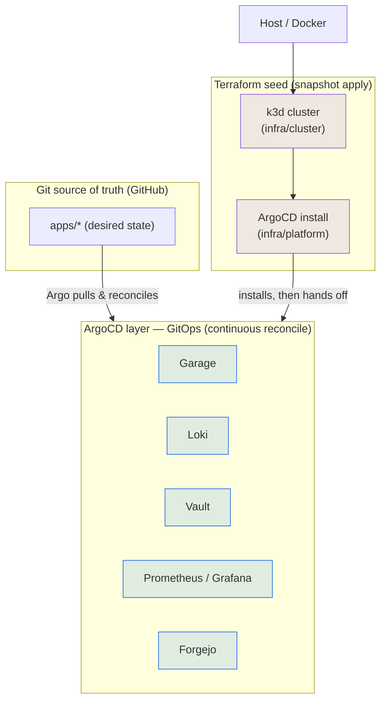

# ADR-0003: Terraform-vs-ArgoCD delivery boundary (thin TF seed, fat GitOps)

- Status: accepted
- Date: 02-Jul-26

## Context

Two tools can create in-cluster resources: Terraform (`helm`/`kubernetes`
providers in `infra/platform`) and ArgoCD (`Application`s reconciling `apps/`).
Without an explicit line, both drift toward doing everything, and workloads
(Garage, Loki, Vault, observability, Forgejo) could land in either. ADR-0001
already stated "TF owns up to and including ArgoCD; ArgoCD owns `apps/`" but
left the workload set ambiguous.

## Decision

**Thin TF seed, fat GitOps layer.**

- **Terraform owns the seed only**: `infra/cluster` (k3d) + `infra/platform`
  (ArgoCD install + the minimal bootstrap creds ArgoCD needs to reach Git).
- **ArgoCD owns everything above**: Garage, Loki, Vault, observability, Forgejo,
  all app workloads, as `Application`s sourced from `apps/` in the GitHub repo.
- No `helm_release` for workloads. `infra/platform` shrinks to essentially the
  ArgoCD install.
- Ordering across apps: not TF `depends_on`. Planned as ArgoCD sync waves; as built, each consumer retries until its dependency is ready (see Consequences).
- Imperative one-shots inside a workload (e.g. Garage layout/bucket/key init)
  = Kubernetes Jobs with an ArgoCD `PostSync` hook, kept idempotent.

```
  Git (GitHub) = desired state (apps/*)
        │  ArgoCD pulls, diffs, reconciles (continuous)
 ═══════╪══════════════════════════════════════  GitOps line
  ARGO  │  Garage · Loki · Vault · observability · Forgejo · services
 ═══════╪══════════════════════════════════════  bootstrap line
  TF platform : ArgoCD install (+ bootstrap creds)
 ──────────────────────────────────────────────
  TF cluster  : k3d (nodes, kubeconfig)
 ──────────────────────────────────────────────
  Host / Docker
```

Mermaid (renders on GitHub):



## Rationale

- **TF is a snapshot applier; ArgoCD is a continuous reconciler.** Workloads
  want audit, revert, drift-detection, self-heal, which is ArgoCD's job. TF
  managing runtime apps causes plan/apply drift against a live cluster, puts
  cluster credentials in the TF runner, and gives no continuous reconcile.
- **The seed cannot be GitOps.** ArgoCD cannot install itself before it exists,
  and cannot manage the cluster it runs on. That layer is TF's, and only that.
- **Gray-zone test:** *does ArgoCD need it to function?* Yes (the cluster,
  ArgoCD itself, the Git cred) → seed/TF. No (Garage, Loki, Vault, …) → GitOps.
- **Sequencing consequence:** Garage is a workload, so it deploys as an Argo
  app and therefore cannot precede ArgoCD. Task order re-sequenced: ArgoCD =
  Task 02, Garage = Task 03.

## Bootstrap: GitHub, not in-cluster Forgejo

- The **cold-start source stays external** (GitHub, or a local git bundle),
  independent of cluster state. ArgoCD is not limited to GitHub (Forgejo is a
  normal, Gitea-compatible Git server Argo supports); the constraint is a
  **bootstrap cycle**, not tooling. Which side is the *primary* source is a
  separate choice (see the Forgejo-primary variant below).
- Sourcing apps from the in-cluster Forgejo that ArgoCD itself deploys is a
  chicken-egg: fresh cluster → Argo up → needs apps from Forgejo → Forgejo not
  deployed yet → deadlock.
- **Day-2 tiering:** Tier 0 (bootstrap: Argo config + Forgejo deploy) stays
  reachable at cold start, GitHub or a local git bundle, **forever**. Tier 1
  (app repos, dev workflow) may migrate to Forgejo once it is up (repoint
  `Application.repoURL`; Argo can watch GitHub and Forgejo in parallel).

## Bootstrap variant: Forgejo-primary (when GitHub is the unreliable side)

Two roles are separable: **human platform** (push/browse/PR) vs **Argo source**
(reconcile). The Argo *source* only needs to be reachable when Argo re-syncs;
the *bootstrap* source only at cold start. Pick per which side is reliable.

- **Default (GitHub reliable):** Argo reads GitHub; Forgejo optional day-2.
- **Forgejo-primary (GitHub flaky, the target here):**
  - You push to **Forgejo** (in-cluster, LAN, reliable). Forgejo **push-mirrors
    to GitHub** as a DR copy.
  - Point day-2 `Application`s' `repoURL` at **Forgejo**, so reconcile is
    LAN-local and survives GitHub/WAN outages. GitHub demoted to **DR mirror**.
  - A GitHub outage then touches nothing: daily work on Forgejo, reconcile from
    Forgejo, running apps unaffected regardless.
  - **Cold-start carve-out remains:** the seed that deploys Forgejo cannot live
    in Forgejo. Source it from GitHub **or** an offline **git bundle** on the
    box, so even a GitHub outage during a full rebuild is survivable.

Tradeoff table:

| Argo source | Reconcile survives GitHub down? | Cold-start needs |
|---|---|---|
| GitHub | no (syncs pause; running apps fine) | GitHub |
| Forgejo (day-2) | yes | GitHub mirror **or** local git bundle |

**New SPOF caution:** self-hosting Forgejo to dodge GitHub outages makes Forgejo
(one pod, one PV) a single point of failure. Net reliability improves only with
backups: Forgejo PV backup (repos + SQLite) + the GitHub push-mirror + local
clones. Git's distributed nature (every clone = full history) then makes loss
near-impossible.

## Consequences

- `infra/platform` shrinks to ~just ArgoCD; most prior "platform via helm"
  intent moves to `apps/`. Amends ADR-0001's platform scope.
- Cross-app ordering: no sync waves (ordering whole `Application`s in an
  app-of-apps needs a custom health check). Consumers retry instead: Loki's
  Vault agent waits for the key, Loki retries Garage. Vault seeding is a
  local step (`mise run vault`) after Garage init, so the rebuild order
  is fixed there.
- Imperative bootstraps (Garage init) need idempotent PostSync-hook Jobs.
- Webhook race on a fresh rebuild: a Vault consumer pod created before the Vault agent injector's webhook exists is never injected. Fixed by a targeted restart at the end of `mise run vault` (only pods not injected or stuck in agent backoff), not by sync waves: Vault stays NotReady until the manual unseal, so later waves would block on it (found in the 23-Oct-26 DR drill).
- Rejected: TF `helm_release` for all workloads (drift, creds-in-TF, no
  reconcile); a second in-cluster Git as the bootstrap source (chicken-egg).

## Related

ADR-0001 (repo layout / state boundary; this ADR refines its platform scope).
ADR-0002 (Garage object store).
